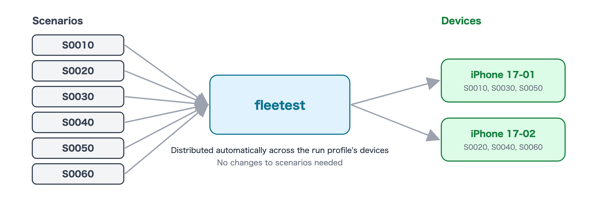

# Running tests

[in Japanese(日本語)](running_tests_ja.md)

Run all the tests you have created in project1 so far.

## 1. Run

### Prompt for the AI

```text
Run project1 on iOS (ios-run) and report the results when it's done.
```

<details>
<summary><b>If you do it manually (click to show details)</b></summary>

```bash
# Everything
../fleetest-mobile/.build/debug/fleetest run --project project1 --profile ios-run

# Per class (file) or per single test
../fleetest-mobile/.build/debug/fleetest run --project project1 --profile ios-run --scenario <ClassName>
../fleetest-mobile/.build/debug/fleetest run --project project1 --profile ios-run --scenario <ClassName>.<methodName>
```

`<ClassName>` is the scenario's class name (it is inside the Swift file under `scenarios/`).

In VSCode, select a scenario in the Test Explorer and click "Run" (choose the run profile with
`fleetest: Select Run Profile` in the Command Palette; if there is only one, it is selected automatically).

</details>
<br>

Expected result:

- `ios-run` defines several devices. The scenarios are distributed to them automatically and run in parallel.



<br>

Next: [Reading results and investigating failures](investigating_failures.md)

### Link
- [index](../index.md)
