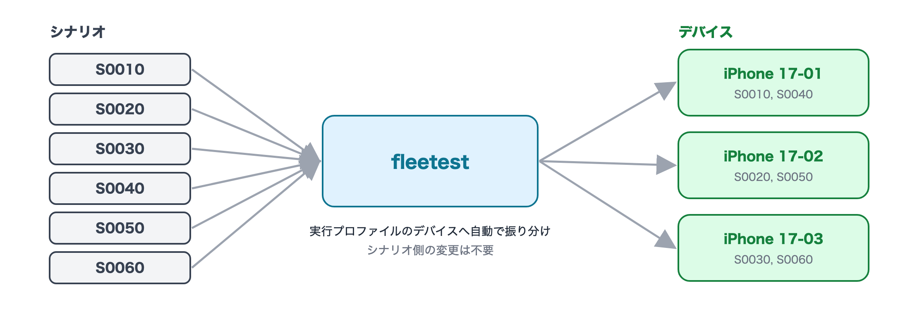

# テストを実行する

[in English](running_tests.md)

ここまでの手順で project1 に作成したテストをまとめて実行します。

## 1. 実行する

### AIへの指示文

```text
project1 を iOS(ios-run)で実行し、終わったら成否を報告して。
```

<details>
<summary><b>手動で実行する場合(クリックで詳細表示)</b></summary>

```bash
# 全部
../foundation-tester/.build/debug/fleetest run --project project1 --profile ios-run

# クラス(ファイル)単位・1本単位
../foundation-tester/.build/debug/fleetest run --project project1 --profile ios-run --scenario <クラス名>
../foundation-tester/.build/debug/fleetest run --project project1 --profile ios-run --scenario <クラス名>.<メソッド名>
```

`<クラス名>` はシナリオのクラス名(`scenarios/` 配下の Swift ファイルの中にあります)です。

VSCode では Test Explorer でシナリオを選び、「実行」をクリックします(実行プロファイルはコマンドパレットの
`fleetest: 実行プロファイルを選択` で選びます。1つしか無ければ自動で選ばれます)。

</details>
<br>

期待する結果:

- `ios-run` には複数台のデバイスが定義されています。シナリオはそれらのデバイスに自動で振り分けら、並列に実行されます。



<br>

次へ: [結果を読み、失敗を調べる](investigating_failures_ja.md)

### Link
- [index](../index_ja.md)
