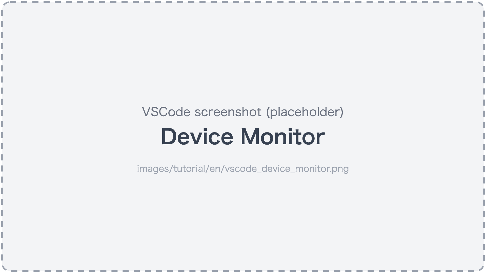
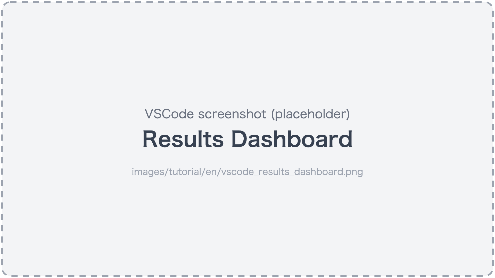

# Watching in VSCode

[in Japanese(日本語)](watching_in_vscode_ja.md)

Watch the AI assistant create and run tests in the VSCode extension (the extension comes with the [Quick start](../quick-start.md)).

## 1. Open the Device Monitor

Run "fleetest: Show Device Monitor" from the Command Palette, or click **fleetest mobile** in the status bar at the bottom left of VSCode.

Expected result:

- Three panes, top to bottom: the **Line View** (the row of device tiles), the **Grid View** (the enlarged screen of the selected device) and the **Run Log View** (the run log of the selected device).



## 2. Select a tile to see the enlarged screen and the run log

Click a tile in the Line View to select the device. It is easiest to see when you try this while giving the AI assistant the following prompt.

### Prompt for the AI

```text
In project1, run the add-to-cart test with the run profile ios-run.
```

Expected result:

- The selected device's screen appears in the Grid View.
- The selected device's run log appears in the Run Log View.
- With nothing selected, both say "Select a device".

## 3. Touch it yourself (Live Control)

Select just one device in the Line View, and operation buttons appear to the right of the enlarged screen in the Grid View. Operate the device screen with the mouse (click to tap, drag to swipe, Command(⌘)+click to double-tap, Option(⌥)+drag to trace the exact path).

Expected result:

- The place you click is tapped on the device.
- The screen updates.
- The element list and the operation log appear to the right of the enlarged screen.

## 4. Run from the Test Explorer

Open the Test Explorer (VSCode's Testing view), choose a run profile with `fleetest: Select Run Profile`, then select a test and press "Run" or "Run (dry-run)".
When there is only one run profile, it is selected automatically even if you do not choose.

Expected result:

- Pass/fail right there.
- You can open the report from a failed test.


## 5. Watch the recordings

Open the "Test Sessions" tab (it switches there automatically if the Device Monitor is showing when a run finishes).

Expected result:

- Each scenario's video and steps.
- You can also export the results to Excel.

### Prompt for the AI

```text
For iOS runs of project1, keep recordings only for failed scenarios.
```

Expected result:

- `recordFailuresOnly` of the run profile ios-run becomes true (check it in the "Profiles" tab).


## 6. See the Results Dashboard

Run "fleetest: Open Results Dashboard" from the Command Palette.

Expected result:

- The run history.
- Newly failing tests.
- Recovered tests.
- The success rate.



## When the Mac is slow

When many devices running in parallel make things slow, turn "Live Updates" in the Device Monitor OFF (streaming stops; status display continues).

Learn more:

- [VSCode extension](../reference/tools/vscode_extension.md)

<br>

Next: [Checking the sandbox and opening the holes you need](../security/sandbox.md)

### Link
- [index](../index.md)
