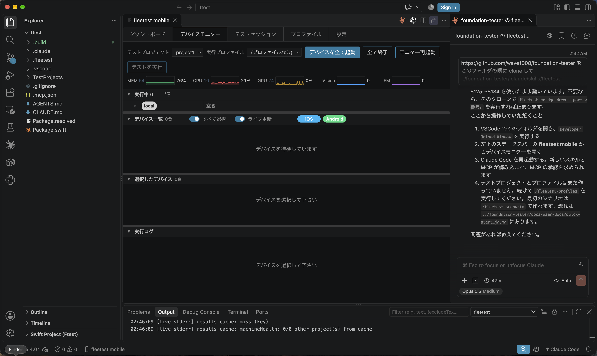
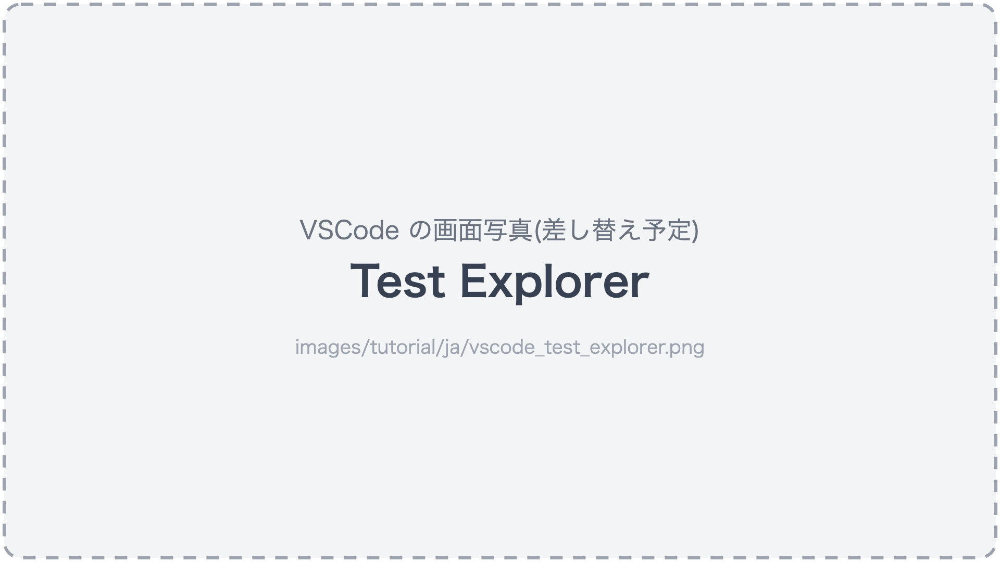
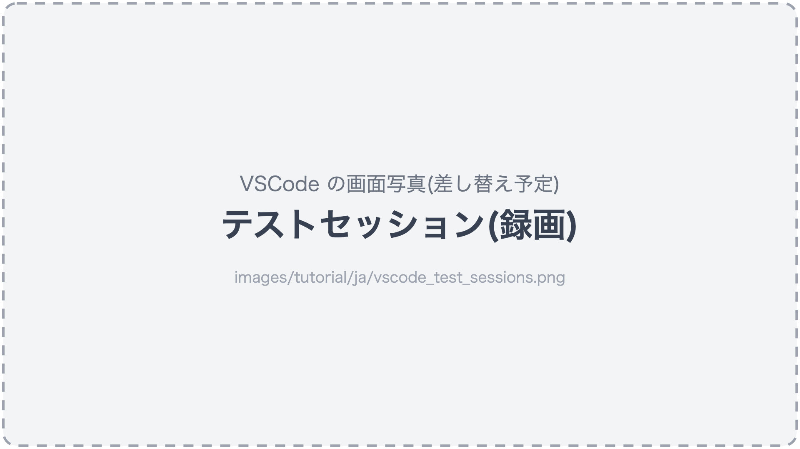

# VSCode で見る

[in English](watching_in_vscode.md)

AIアシスタントがテストを作り、実行している間の様子を、VSCode 拡張で見ます(拡張は[クイックスタート](../quick-start_ja.md)で入ります)。

## 1. デバイスモニターを開く

コマンドパレットで「fleetest: デバイスモニターを表示」を実行するか、VSCode 左下のステータスバーの **fleetest mobile** をクリックします。

期待する結果:

- 上から **ラインビュー**(デバイスのタイルの並び)・**グリッドビュー**(選択したデバイスの拡大表示)・**実行ログビュー**(選択したデバイスの実行ログ)の3ペイン。



## 2. タイルを選んで拡大表示と実行ログを見る

ラインビューのタイルをクリックしてデバイスを選びます。AIアシスタントに次の指示を出している間に試すと分かりやすくなります。

### AIへの指示文

```text
project1 で、カートに追加するテストを iOS の実行プロファイル ios-run で実行して。
```

期待する結果:

- 選んだデバイスの画面がグリッドビューに出ます。
- 選んだデバイスの実行ログが実行ログビューに出ます。
- 何も選んでいないと、グリッドビュー・実行ログビューの両方に「デバイスを選択して下さい」と出ます。

## 3. 自分の手で触る(ライブ操作)

ラインビューでデバイスを1台だけ選ぶと、グリッドビューの拡大表示の右隣に操作のボタンが出ます。デバイスの画面をマウスで操作します(クリックでタップ・ドラッグでスワイプ・Command(⌘)+クリックでダブルタップ・Option(⌥)+ドラッグで指の軌跡どおりになぞる)。

期待する結果:

- クリックした位置がデバイスでタップされます。
- 画面が更新されます。
- 要素一覧と操作記録が拡大表示の右に出ます。

## 4. Test Explorer から実行する

VSCode の Testing ビューを開き、`fleetest: 実行プロファイルを選択` で使う実行プロファイルを選んでから、テストを選んで「実行」または「実行 (dry-run)」を押します。
実行プロファイルが1つしか無いときは、選ばなくても自動で選ばれます。

期待する結果:

- 成否がその場で出ます。
- 失敗したテストからレポートを開けます。



## 5. 録画を見る

「テストセッション」タブを開きます(デバイスモニターを表示したまま実行が終わると、自動で切り替わります)。

期待する結果:

- シナリオごとの動画と手順。
- 結果の Excel 書き出しもできます。

### AIへの指示文

```text
project1 の iOS の実行で、失敗したシナリオの録画だけ残すようにして。
```

期待する結果:

- 実行プロファイル ios-run の `recordFailuresOnly` が true になります(「プロファイル」タブで確認します)。



## 6. 結果ダッシュボードを見る

コマンドパレットで「fleetest: 結果ダッシュボードを開く」を実行します。

期待する結果:

- 実行の履歴。
- 新たに落ちたテスト。
- 回復したテスト。
- 成功率。


## Mac が重いとき

たくさんのデバイスを並列に動かして重いときは、デバイスモニターの「ライブ更新」を OFF にします(画面の配信が止まり、状態の表示は続きます)。

もっと詳しく:

- [VSCode 拡張](../reference/tools/vscode_extension_ja.md)

<br>

次へ: [サンドボックスを確かめて、必要な穴をあける](../security/sandbox_ja.md)

### Link
- [index](../index_ja.md)
